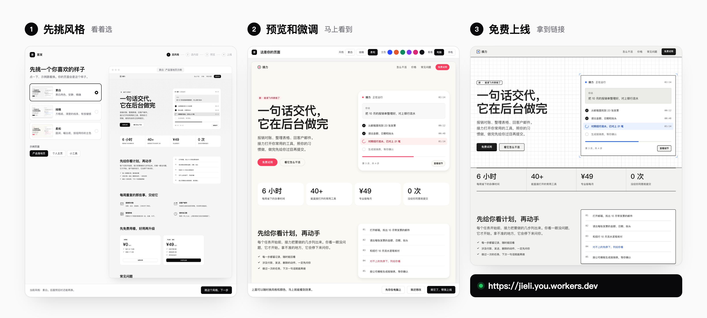
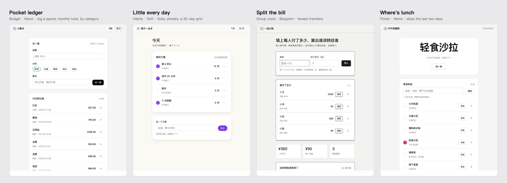

<div align="center">

# Shoufa 首发

**Your first product, live. No code.**

A skill for Claude Code and any agent that reads skills.<br>
Click through a short form in your browser, get a personal homepage, a product page or a small working tool, and put it online for free.

[Live demo](https://shoufa.kehaoran.ai) · [Try the form](https://shoufa.kehaoran.ai/try/) · [Install](#install) · [简体中文](README.zh-CN.md)

[](LICENSE)
[](#install)
[](#install)
[](https://github.com/kehaoran-ai/neatly)

</div>



```bash
npx skills add kehaoran-ai/shoufa
```

Then tell your agent: *"I want to make a homepage for myself"*, or *"make me a little budgeting tool"*. That's it.

## Who it's for

People who have never built anything for the web and want something real to share: a homepage, a page for an app or a side project, a shop, an event, or a small tool they and their friends will actually use. You never type a command or touch a file. The agent does the work; you click choices.

## How it works

1. **Pick a look.** A form opens in your browser next to a full sample page. Click a look and the sample switches to it, so you choose by seeing.
2. **Say what you're making.** A personal homepage, a product page, a working tool, or one sentence of your own. Pick a main colour, and that's enough for a first version.
3. **Add details, if you like.** Name, a sentence about you or your product, photos, your work, prices, what the tool must do. Everything is optional; blank parts get sample text you can change.
4. **Preview.** Switch the look and colour instantly, check the phone view, and ask for changes. A tool already works inside the preview.
5. **Go live.** A step-by-step page walks you through a free Cloudflare account and one permission click. The agent uploads and hands you a link.

[Try the form on the demo site](https://shoufa.kehaoran.ai/try/). It has no agent behind it, but every look and colour switch works.

## Pages, and tools that work

Every example below was built by an agent with nothing but the skill and a set of form answers.

**Pages:** [Relay, an AI agent's product page](https://shoufa.kehaoran.ai/examples/jieli/) · [Lin Xiaoyu, an illustrator's homepage](https://shoufa.kehaoran.ai/examples/xiaoyu/)

**Tools you can use right now:**



[Pocket ledger](https://shoufa.kehaoran.ai/examples/ledger/) · [Little every day](https://shoufa.kehaoran.ai/examples/habits/) · [Split the bill](https://shoufa.kehaoran.ai/examples/split-bill/) · [Where's lunch](https://shoufa.kehaoran.ai/examples/lunch-picker/)

Each tool is one HTML file with plain JavaScript: no accounts, no server, works offline. Data stays in the browser it was entered in.

## Three looks

Every look sits on [shadcn/ui](https://ui.shadcn.com)'s design tokens, and pages are laid out by [Neatly](https://github.com/kehaoran-ai/neatly), so they come out clean and consistent, without the usual AI tells.

| Mono | Blueprint | Soft |
|---|---|---|
| Black and white, a dot grid, white panels | Grid paper, ink lines, a button you want to press | Warm paper, round shapes, your colour on the button |

## Install

**Claude Code**

```
/plugin marketplace add kehaoran-ai/shoufa
/plugin install shoufa@shoufa
```

**Any agent that reads skills**

```bash
npx skills add kehaoran-ai/shoufa
```

You need Python 3 (already on a Mac). Going live also needs Node.js; the guide tells you how to get it if it's missing.

## Questions

**Does it cost anything?** No. The skill is free and open source, and Cloudflare hosts small sites for free.

**Will it ask for my passwords?** No. Cloudflare asks you directly on its own page whether this computer may publish for you. The agent never sees your password.

**Can I change it later?** Yes. Tell your agent what to change; it edits and publishes again.

**Can I use my own domain?** Yes, add it in the Cloudflare dashboard once it is live.

## What is inside

```
skills/shoufa/
  SKILL.md          how the agent runs the five steps
  scripts/ask.py    shows the forms in your browser and passes your answers back
  forms/            the start, preview and go-live pages
  systems/          the shadcn/ui base, the three looks and the parts for tools
  reference/        how to build a working tool
  samples/          the sample page, homepage and tool the start form shows
  neatly/           the Neatly engine (layouts, checker), copied from Neatly
examples/           finished pages and tools, as on the demo site
scripts/site.py     builds the demo site
```

Everything runs on your own computer until you choose to publish.

## License

MIT, by [Ke Haoran](https://github.com/kehaoran-ai).
