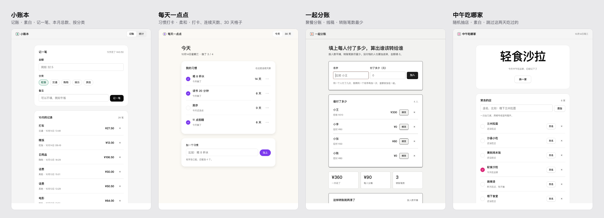

<div align="center">

# 首发

**不写代码，做出第一个上线的产品。**

给 Claude Code 等 AI 编程工具用的 skill。<br>
在浏览器里点几个选择题，做出个人主页、产品落地页，或者一个能直接用的小工具，再免费放到网上。

[在线演示](https://shoufa.kehaoran.ai/?lang=zh) · [试试表单](https://shoufa.kehaoran.ai/try/?lang=zh) · [安装](#安装) · [English](README.md)

[](LICENSE)
[](#安装)
[](#安装)
[](https://github.com/kehaoran-ai/neatly)

</div>


```bash
npx skills add kehaoran-ai/shoufa
```

然后跟 AI 说一句：「我想给自己做个主页」，或者「帮我做个记账的小工具」。就够了。

## 给谁用

从没做过网页、想做出一个能发给别人看的东西的人：个人主页、一个 App 或副业的介绍页、一家小店、一场活动，或者一个自己和朋友真会用的小工具。你不用敲命令，也不用碰任何文件。AI 干活，你只管点选。

## 怎么用

1. **先挑风格。** 浏览器里弹出一张表单，旁边放着一个完整的示例页面。点哪种风格，示例就换成哪种，看着选。
2. **选做什么。** 个人主页、产品落地页、能用的小工具，或者用一句话说。再选个主色，就能出第一版。
3. **补内容（想补就补）。** 名字、一句话介绍、照片、作品、价格、工具要能做的事……全部可选；空着的地方先放示例文字，之后能改。
4. **预览。** 随时换风格、换颜色、看手机效果，不满意就说要改哪里。小工具在预览里就能用。
5. **上线。** 一步步带你注册免费的 Cloudflare 账号，点一次授权。AI 上传，最后给你一个能分享的链接。

[在演示站上试试表单](https://shoufa.kehaoran.ai/try/?lang=zh)。演示版不连 AI，但风格和颜色都能随便换。

## 页面，和真能用的小工具

下面每一个都是 AI 只读了这个 skill、照着表单答案做出来的。

**页面：**[接力：AI agent 产品的落地页](https://shoufa.kehaoran.ai/examples/jieli/) · [林小雨：插画师的个人主页](https://shoufa.kehaoran.ai/examples/xiaoyu/)

**现在就能用的小工具：**



[小账本](https://shoufa.kehaoran.ai/examples/ledger/) · [每天一点点](https://shoufa.kehaoran.ai/examples/habits/) · [一起分账](https://shoufa.kehaoran.ai/examples/split-bill/) · [中午吃哪家](https://shoufa.kehaoran.ai/examples/lunch-picker/)

每个小工具都是一个 HTML 文件，不用注册、不连服务器、断网也能用，数据只存在你自己的浏览器里。

## 三种风格

三种风格都建在 [shadcn/ui](https://ui.shadcn.com) 的设计变量上，版式由 [Neatly](https://github.com/kehaoran-ai/neatly) 排，干净统一，没有那股 AI 味。

| 素白 | 线稿 | 柔和 |
|---|---|---|
| 黑白两色、点阵、白面板 | 方格纸、墨线、有按键感的按钮 | 暖白底、圆角、按钮用你的主色 |

## 安装

**Claude Code**

```
/plugin marketplace add kehaoran-ai/shoufa
/plugin install shoufa@shoufa
```

**其他支持 skill 的工具**

```bash
npx skills add kehaoran-ai/shoufa
```

需要 Python 3（Mac 自带）。上线那一步还需要 Node.js，没装的话指引页会告诉你怎么装。

## 常见问题

**要花钱吗？** 不用。skill 免费开源，Cloudflare 免费托管小网站。

**会让我输密码吗？** 不会。Cloudflare 会在它自己的页面上问你，能不能让这台电脑帮你发布。AI 碰不到你的密码。

**以后还能改吗？** 能。跟 AI 说要改哪里，它改好再发一次。

**能用自己的域名吗？** 能，上线后在 Cloudflare 后台加上就行。

## 目录

```
skills/shoufa/
  SKILL.md          AI 怎么带你走完五步
  scripts/ask.py    在浏览器里显示表单，把你的选择交给 AI
  forms/            开始、预览、上线三个页面
  systems/          shadcn/ui 底座、三种风格、做小工具用的组件
  reference/        怎么做一个能用的小工具
  samples/          开始表单里展示的示例页面、主页和小工具
  neatly/           Neatly 引擎（版式、检查脚本），从 Neatly 复制过来
examples/           做好的页面和小工具，和演示站上的一样
scripts/site.py     生成演示站
```

发布之前，一切都只在你自己的电脑上。

## 许可

MIT，作者 [柯浩然](https://github.com/kehaoran-ai)。
